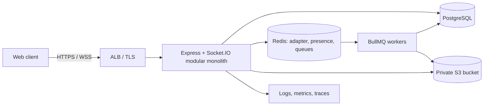
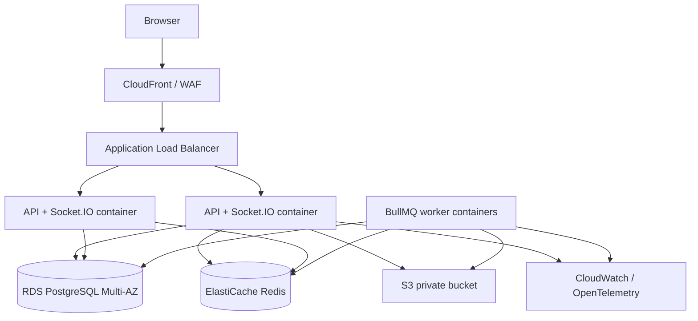
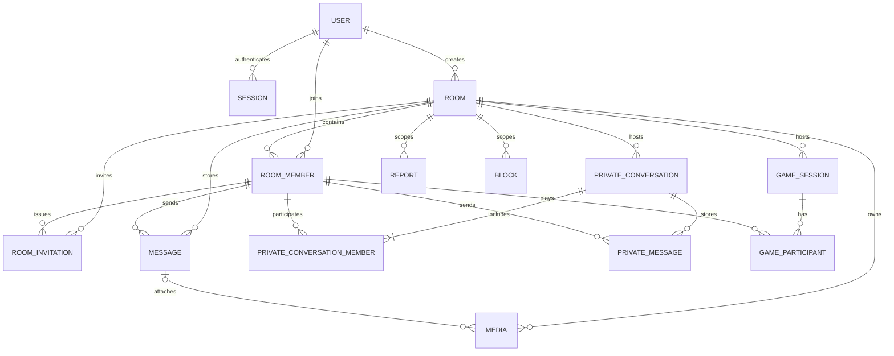

# Rabbit Hole Backend Architecture Blueprint

**Status:** Architecture proposal for an empty repository  
**Scope:** Production-minded modular monolith; no backend implementation  
**Stack:** Node.js, TypeScript, Express, PostgreSQL, Prisma, Socket.IO, Redis, BullMQ, S3, Zod, OpenAPI, Vitest, Supertest, Docker, AWS

## 1. Architecture overview

Rabbit Hole is a temporary-room platform. The backend is authoritative for identity, membership, roles, expiry, persistence, invitation acceptance, game state, and deletion. A modular monolith keeps deployment and transactions straightforward for a small team while preserving feature boundaries.

Run one application codebase with independently scalable HTTP/socket instances and workers. PostgreSQL is the source of truth. Redis carries ephemeral presence, Socket.IO fan-out, rate-limit counters, and BullMQ queues; it is not durable room state. S3 stores media objects, with object keys and ownership recorded in PostgreSQL. Room data is deleted through an idempotent lifecycle workflow; database deletion and S3 cleanup are coordinated and retried rather than treated as one atomic transaction.

**MVP assumptions to validate before implementation:** accounts use email and password; authentication uses revocable server-side sessions in PostgreSQL with opaque cookie tokens; joining requires an active room and valid invitation; expiry is absolute UTC `expiresAt` and extension is authorized; private-chat invitations are scoped to two members of one room; codenames are visible only within their room. These choices minimize token leakage and cross-room identity correlation. Open decisions are listed in §14.

### High-level architecture



### Initial Prisma schema proposal

This is a compact proposal, not a deployable migration. Complete inverse relation fields consistently when implementing. Add SQL checks for invariants Prisma cannot express (expiry ordering, legal status transitions, exactly two private participants); use composite foreign keys or equivalent constraints to ensure referenced members belong to the same room as their message/conversation/game.

```prisma
generator client { provider = "prisma-client-js" }
datasource db { provider = "postgresql"; url = env("DATABASE_URL") }

enum RoomStatus { ACTIVE DELETING CLOSED }
enum MemberRole { OWNER MODERATOR MEMBER }
enum MemberStatus { ACTIVE LEFT REMOVED }
enum InvitationStatus { ACTIVE REVOKED EXPIRED ACCEPTED }
enum MessageStatus { ACTIVE REDACTED }
enum PrivateInviteStatus { PENDING ACCEPTED REJECTED EXPIRED }
enum GameStatus { WAITING RUNNING FINISHED CANCELLED }
enum ReportStatus { OPEN REVIEWED DISMISSED ACTIONED }

model User {
  id String @id @default(uuid()) @db.Uuid
  email String @unique
  passwordHash String
  createdAt DateTime @default(now()) @db.Timestamptz(6)
  updatedAt DateTime @updatedAt @db.Timestamptz(6)
  sessions Session[]
  memberships RoomMember[]
  createdRooms Room[]
}
model Session {
  id String @id @default(uuid()) @db.Uuid
  tokenHash String @unique
  userId String @db.Uuid
  expiresAt DateTime @db.Timestamptz(6)
  revokedAt DateTime? @db.Timestamptz(6)
  createdAt DateTime @default(now()) @db.Timestamptz(6)
  user User @relation(fields:[userId], references:[id], onDelete:Cascade)
  @@index([userId, expiresAt])
}
model Room {
  id String @id @default(uuid()) @db.Uuid
  creatorId String @db.Uuid
  name String
  status RoomStatus @default(ACTIVE)
  createdAt DateTime @default(now()) @db.Timestamptz(6)
  expiresAt DateTime @db.Timestamptz(6)
  deletingAt DateTime? @db.Timestamptz(6)
  creator User @relation(fields:[creatorId], references:[id], onDelete:Restrict)
  members RoomMember[]
  invitations RoomInvitation[]
  messages Message[]
  media Media[]
  conversations PrivateConversation[]
  games GameSession[]
  @@index([status, expiresAt])
}
model RoomMember {
  id String @id @default(uuid()) @db.Uuid
  roomId String @db.Uuid
  userId String @db.Uuid
  codename String
  role MemberRole @default(MEMBER)
  status MemberStatus @default(ACTIVE)
  joinedAt DateTime @default(now()) @db.Timestamptz(6)
  leftAt DateTime? @db.Timestamptz(6)
  room Room @relation(fields:[roomId], references:[id], onDelete:Cascade)
  user User @relation(fields:[userId], references:[id], onDelete:Restrict)
  @@unique([roomId, userId])
  @@unique([roomId, codename])
  @@index([userId, status])
  @@index([roomId, status, role])
}
model RoomInvitation {
  id String @id @default(uuid()) @db.Uuid
  roomId String @db.Uuid
  issuerMemberId String @db.Uuid
  tokenHash String @unique
  codeHash String?
  status InvitationStatus @default(ACTIVE)
  expiresAt DateTime @db.Timestamptz(6)
  maxUses Int @default(1)
  uses Int @default(0)
  createdAt DateTime @default(now()) @db.Timestamptz(6)
  room Room @relation(fields:[roomId], references:[id], onDelete:Cascade)
  issuer RoomMember @relation(fields:[issuerMemberId], references:[id], onDelete:Restrict)
  @@index([roomId, status, expiresAt])
}
model Message {
  id String @id @default(uuid()) @db.Uuid
  roomId String @db.Uuid
  senderMemberId String @db.Uuid
  clientMessageId String
  body String
  status MessageStatus @default(ACTIVE)
  createdAt DateTime @default(now()) @db.Timestamptz(6)
  room Room @relation(fields:[roomId], references:[id], onDelete:Cascade)
  sender RoomMember @relation(fields:[senderMemberId], references:[id], onDelete:Restrict)
  media Media[]
  @@unique([roomId, senderMemberId, clientMessageId])
  @@index([roomId, createdAt, id])
}
model PrivateConversation {
  id String @id @default(uuid()) @db.Uuid
  roomId String @db.Uuid
  status PrivateInviteStatus @default(PENDING)
  invitedMemberId String @db.Uuid
  createdAt DateTime @default(now()) @db.Timestamptz(6)
  acceptedAt DateTime? @db.Timestamptz(6)
  room Room @relation(fields:[roomId], references:[id], onDelete:Cascade)
  participants PrivateConversationMember[]
  messages PrivateMessage[]
  @@index([roomId, status, createdAt])
}
model PrivateConversationMember {
  id String @id @default(uuid()) @db.Uuid
  conversationId String @db.Uuid
  memberId String @db.Uuid
  conversation PrivateConversation @relation(fields:[conversationId], references:[id], onDelete:Cascade)
  member RoomMember @relation(fields:[memberId], references:[id], onDelete:Restrict)
  @@unique([conversationId, memberId])
}
model PrivateMessage {
  id String @id @default(uuid()) @db.Uuid
  conversationId String @db.Uuid
  senderMemberId String @db.Uuid
  clientMessageId String
  body String
  createdAt DateTime @default(now()) @db.Timestamptz(6)
  conversation PrivateConversation @relation(fields:[conversationId], references:[id], onDelete:Cascade)
  sender RoomMember @relation(fields:[senderMemberId], references:[id], onDelete:Restrict)
  @@unique([conversationId, senderMemberId, clientMessageId])
  @@index([conversationId, createdAt, id])
}
model Media {
  id String @id @default(uuid()) @db.Uuid
  roomId String @db.Uuid
  messageId String? @db.Uuid
  objectKey String @unique
  mimeType String
  byteSize BigInt
  checksum String?
  createdAt DateTime @default(now()) @db.Timestamptz(6)
  room Room @relation(fields:[roomId], references:[id], onDelete:Cascade)
  message Message? @relation(fields:[messageId], references:[id], onDelete:SetNull)
  @@index([roomId])
}
model GameSession {
  id String @id @default(uuid()) @db.Uuid
  roomId String @db.Uuid
  gameType String
  status GameStatus @default(WAITING)
  state Json
  createdAt DateTime @default(now()) @db.Timestamptz(6)
  endedAt DateTime? @db.Timestamptz(6)
  room Room @relation(fields:[roomId], references:[id], onDelete:Cascade)
  participants GameParticipant[]
  @@index([roomId, status])
}
model GameParticipant {
  id String @id @default(uuid()) @db.Uuid
  gameId String @db.Uuid
  memberId String @db.Uuid
  game GameSession @relation(fields:[gameId], references:[id], onDelete:Cascade)
  member RoomMember @relation(fields:[memberId], references:[id], onDelete:Restrict)
  @@unique([gameId, memberId])
}
model Report {
  id String @id @default(uuid()) @db.Uuid
  roomId String @db.Uuid
  reporterMemberId String @db.Uuid
  targetMemberId String? @db.Uuid
  messageId String? @db.Uuid
  reason String
  status ReportStatus @default(OPEN)
  createdAt DateTime @default(now()) @db.Timestamptz(6)
  room Room @relation(fields:[roomId], references:[id], onDelete:Cascade)
  @@index([roomId, status, createdAt])
}
model Block {
  id String @id @default(uuid()) @db.Uuid
  roomId String @db.Uuid
  blockerMemberId String @db.Uuid
  blockedMemberId String @db.Uuid
  createdAt DateTime @default(now()) @db.Timestamptz(6)
  room Room @relation(fields:[roomId], references:[id], onDelete:Cascade)
  @@unique([roomId, blockerMemberId, blockedMemberId])
  @@index([roomId, blockedMemberId])
}
```

Use transactions for room creation plus owner membership; invitation redemption plus membership and use count; owner departure/transfer; message plus media attachment; private invitation acceptance; and game state transitions. The schema above needs inverse relation fields added in implementation (e.g. `RoomMember` arrays for messages, issued invitations, conversations, and games; `Room` arrays for reports/blocks). Enforce owner membership and exactly two private participants in transactional services plus SQL constraints/triggers as appropriate. Do not use soft deletion instead of room purge.

## 4. REST API architecture

All routes use `/api/v1`. Success: `{ "data": ..., "meta": ... }`; error: `{ "error": { "code": "...", "message": "...", "requestId": "...", "details": [...] } }`. History uses opaque cursors over stable `(createdAt,id)`. Zod validates inputs; DTOs omit internal account IDs and secrets. Authentication uses secure, HttpOnly, SameSite cookies; state-changing cookie-authenticated requests require CSRF/origin checks. Standard codes: `401` unauthenticated, `403` unauthorized, `404` absent/concealed, `409` conflict, `410` expired, `422` invalid, `429` rate limited.

| Method and path | Auth / authorization | Input → response |
|---|---|---|
| POST `/auth/register` | Public, rate limited | email/password → `201` user summary; `409` duplicate |
| POST `/auth/login` | Public, rate limited | credentials → `200` session cookie and summary; `401` invalid |
| POST `/auth/logout` | Session | revoke current session → `204` |
| GET `/auth/session` | Session | → current user/session summary |
| GET `/users/me` | Session | → profile |
| PATCH `/users/me` | Session | allowed settings → updated profile; `422` invalid |
| DELETE `/users/me` | Session + reauthentication | request deletion → `202`; account policy applies |
| POST `/rooms` | Session | name, duration/options → `201` room + owner membership; `422/429` |
| GET `/rooms/{roomId}` | Session + active member | → room details; `404/410` |
| PATCH `/rooms/{roomId}` | Owner/moderator policy | fields → room; `403/404/409` |
| POST `/rooms/{roomId}/extend` | Active owner/moderator | duration → new expiry; `403/409/422` |
| POST `/rooms/{roomId}/close` | Owner | → `202` purge queued; `403/409` |
| POST `/rooms/{roomId}/transfer` | Owner; target active member | memberId → new owner atomically; `409` race |
| POST `/rooms/{roomId}/members/join` | Session + invitation | token/code → membership and codename; `410/409` |
| GET `/rooms/{roomId}/members` | Active member | cursor → room codenames and roles |
| DELETE `/rooms/{roomId}/members/me` | Active member | leave; owner departure transfers atomically; `204` |
| DELETE `/rooms/{roomId}/members/{memberId}` | Owner/moderator | remove member; `403/404` |
| POST `/rooms/{roomId}/invitations` | Owner/moderator policy | expiry, maxUses, optional code → raw one-time token `201` |
| POST `/rooms/{roomId}/invitations/{id}/revoke` | Issuer/owner | → `204` |
| GET `/rooms/{roomId}/messages` | Active member | cursor/limit → history; `410` expired |
| POST `/rooms/{roomId}/private-invitations` | Active member | recipientMemberId → pending invite `201`; blocked/duplicate `409` |
| POST `/private-invitations/{id}/accept` | Invited active member | → conversation `201`; `409/410` |
| POST `/private-invitations/{id}/reject` | Invited active member | → `204` |
| GET `/private-conversations/{id}/messages` | Participant + active room member | cursor → messages; `403/404` |
| POST `/media/upload-intents` | Session + active member | filename, MIME, size → signed upload URL and media ID; `413/422` |
| POST `/media/{id}/complete` | Uploader + active member | checksum/metadata → validated media; `409` |
| DELETE `/media/{id}` | Uploader/moderator | → `202` cleanup queued |
| POST `/rooms/{roomId}/games` | Active member | gameType/options → session `201` |
| GET `/rooms/{roomId}/games/{gameId}` | Active member | → public state |
| POST `/rooms/{roomId}/games/{gameId}/join` | Active member | → participant; `409` |
| POST `/rooms/{roomId}/reports` | Active member | target/reason → report `201`; rate limited |
| POST `/rooms/{roomId}/blocks` | Active member | targetMemberId → block `201`; `409` |
| DELETE `/rooms/{roomId}/blocks/{memberId}` | Block owner | → `204` |

Messages, typing, game moves and private chat can be socket-first; REST history and session management remain available. Any REST message creation uses the same service and idempotency key. OpenAPI documents schemas, auth, cursors, errors and examples, preferably generated from route schemas.

## 5. Socket.IO architecture

Use one namespace initially. Authenticate handshake from the same opaque session cookie; reject invalid, expired or revoked sessions. On room join, verify room active and membership in PostgreSQL; server-assigned socket channels are `room:<uuid>` and `conversation:<uuid>`. Socket channels are routing conveniences, never authorization. Removal, close, expiry or session revoke evicts affected sockets; re-check access on sensitive events. Redis adapter broadcasts across instances. Presence uses expiring heartbeat keys and is best-effort. A transactional outbox is a future option if commit-to-broadcast loss becomes material.

Validate every event envelope, bound payloads, authorize, rate-limit, persist durable state, then acknowledge and broadcast. Ack only after commit. Never trust client sender ID, role, membership, game score, or timestamps. Typing/presence are ephemeral and throttled.

| Client → server event | Payload | Behavior |
|---|---|---|
| `room:join` | `{roomId}` | authorize; join routing channel; return room identity |
| `room:leave` | `{roomId}` | leave channel |
| `group:message:send` | `{roomId, clientMessageId, body, mediaIds?}` | validate/persist; ack and broadcast `group:message:new` |
| `group:typing:start/stop` | `{roomId}` | authorize; broadcast codename with short TTL |
| `private:invite:respond` | `{invitationId, decision}` | verify recipient; accept/reject via service |
| `private:message:send` | `{conversationId, clientMessageId, body}` | verify participants, membership, block policy; persist and broadcast |
| `game:join` | `{gameId}` | authorize and join game channel |
| `game:action` | `{gameId, actionId, action}` | validate move against server state; atomically update and broadcast result |

Server events: `room:member:joined`, `room:member:left`, `room:closed`, `room:expired`, `group:message:new`, `group:message:ack`, `group:typing`, `presence:changed`, `private:invite:new`, `private:invite:updated`, `private:message:new`, `game:state`, `game:ended`, `error`. Payloads use server IDs, codenames and timestamps, never email/account IDs. Reconnect clients fetch missed events from history APIs using last acknowledged cursor; socket replay is not durable storage. Acks return the shared API error shape.

## 6. Background jobs

Use BullMQ queues: `room-lifecycle`, `media-cleanup`, `invitation-cleanup`, and `maintenance`. Room create/extend commits PostgreSQL first, then schedules delayed `room-expire:<roomId>:<expiresAt>`. A periodic reconciler queries indexed active rooms with `expiresAt <= now()` and enqueues missing work, so Redis loss or restart cannot lose expiry. Worker re-reads PostgreSQL: proceed only when still active and due. If extended, no-op and schedule current expiry. If due, mark `DELETING` transactionally and revoke access, delete S3 keys in bounded batches with retry, then delete room and cascading content when object cleanup is acknowledged. Stable job IDs, exponential backoff with jitter, idempotency, failed-job alerts, bounded concurrency and dashboards are required. Invitation validity is checked at use time whether or not cleanup has run. Jobs carry IDs, not content.

## 7. Security architecture

- **Passwords/sessions:** Argon2id with tuned parameters; generic login errors; opaque random session tokens stored hashed; Secure/HttpOnly/SameSite cookies, rotation, expiry and revoke-all. TLS. MFA can follow.
- **Invites/codes:** 256-bit random bearer secret, store hash and constant-time compare; expiry, revocation, use limits and per-IP/account throttles. Room codes use Argon2id or keyed verifier and strict attempt limits. Never log raw secrets.
- **Authorization:** centralized active-membership/role policies on every HTTP, socket, media URL, conversation and job operation. Scope queries by room to avoid IDOR. Use transactions for one-use redemption, role transfer and concurrent state changes.
- **Input:** Zod allowlists/limits; Prisma parameterized queries; escape output and avoid unsafe HTML; CSP in frontend. Cookie auth gets CSRF protection/origin checks. Rate-limit login, room creation, invitations, messages, reports, uploads and socket actions.
- **Media:** private bucket, short-lived signed URLs, MIME sniffing plus allowlist, size caps, random keys, malware scan/quarantine, strip metadata when appropriate; no arbitrary user URLs. Authorize URL creation and cap lifetime at room expiry.
- **WebSocket:** TLS, origin allowlist, handshake auth, event schemas, payload ceiling, per-user/room quotas, revoke-driven disconnect and per-event reauthorization.
- **Abuse/logging:** blocks suppress private traffic per policy; reports have bounded text and restricted staff access. Log request IDs and necessary actor IDs; never log bodies, passwords, tokens, signed URLs or content. Minimize audit records and define retention.
- **Secrets/deletion:** AWS Secrets Manager/Parameter Store, least-privilege IAM, KMS, no image secrets. Purge all room rows and S3 object versions. Define separate encrypted backup expiry and restore-time deletion ledger replay. Expired rooms become inaccessible immediately while physical purge retries.

## 8. Testing strategy

- **Unit:** policies, expiry, roles, invitation verification, game transitions, validation and error mapping with mocked ports.
- **Integration:** repositories against disposable PostgreSQL, migrations and constraints; Redis queues/adapter; S3 adapter mocks or local compatible service.
- **API:** Supertest contracts, cookies/CSRF, validation, rate limits and IDOR/membership checks.
- **Socket:** handshake, admission, persist-before-ack, unauthorized events, reconnect history, cross-instance fan-out.
- **Lifecycle/security:** expiry vs extension race, restart reconciliation, retries/idempotency, object cleanup, cascades, ownership transfer and invitation-use races, private acceptance/rejection, session revoke.
- **Games:** invalid/concurrent moves, reconnect snapshots and server-calculated outcomes.
- **E2E:** ephemeral Postgres/Redis/isolated bucket; register → create → invite → join → chat → private accept → expire → verify inaccessible and purged.

## 9. Deployment architecture



Use Docker multi-stage builds, non-root runtime, health/readiness checks, pinned dependencies, and separate API/worker commands from one image. AWS baseline: ECS/Fargate services, ALB with WebSocket timeout, RDS PostgreSQL Multi-AZ with encrypted automated backups, ElastiCache Redis with TLS/auth and queue-appropriate persistence, private versioned S3 with lifecycle policy, WAF, Secrets Manager, IAM task roles and KMS. Keep services in private subnets except ALB. Redis adapter supports multiple API replicas; enable sticky sessions if long-poll fallback is enabled.

CI runs lint/typecheck/tests, dependency/security scans, builds/signs image, deploys staging, runs migrations as a one-off task, then production rolling deployment with health gates. Use expand/migrate/contract DB changes. Monitor request/socket rates/errors, DB pool/latency, queue lag/retries, active rooms, expiry lag and cleanup backlog. Structured logs/traces carry request/job IDs and redact PII/content. Alert on failed expiry jobs, overdue rooms, queue backlog, DB saturation, errors and backup failures. Practice restore drills; after restore, replay deletion tombstones so expired rooms do not reappear.

## 10. MVP implementation roadmap

| Milestone | Deliverables / files | Dependencies | Acceptance/testing |
|---|---|---|---|
| 1. Foundation | package scripts, TS config, `app.ts`, `server.ts`, config, logger, compose | decisions, Node | startup, health, env validation |
| 2. DB/Prisma | client adapter, schema, migrations | PostgreSQL | clean migration, constraints, seed |
| 3. Auth/users | auth/users files, cookie/session middleware | DB | register/login/logout, hash, revoke, API tests |
| 4. Rooms | room service/repository/routes/schemas | auth | CRUD/close, limits, policy tests |
| 5. Membership | membership feature, codename generator | rooms | join/leave, unique identity, authorization |
| 6. Invitations | service/routes/hash utilities | membership | issue/revoke/one-time redeem, race/throttle tests |
| 7. Lifecycle/ownership | lifecycle service, BullMQ jobs/workers, deletion adapter | rooms/media metadata | reconciler, extension race, transfer and purge tests |
| 8. Realtime foundation | sockets, Redis adapter, handshake | auth/membership/Redis | auth/admission/reconnect tests |
| 9. Group chat | chat service/repository/events | realtime/membership | history, ack/idempotency, access/limits |
| 10. Private chat | private chat and notifications | membership/blocks | acceptance, same-room and race tests |
| 11. Media | media feature, S3 adapter, scan pipeline | membership/S3 | intent, validation, cleanup retry |
| 12. Games | game rules/service/socket events | realtime/membership | authoritative actions/concurrency |
| 13. Moderation | moderation service, limits, reports | chat/membership | block/report/remove/audit policy |
| 14. Production hardening | OpenAPI, observability, CI/CD, infra | all modules | threat review, e2e, restore/deletion drills |

Each milestone includes migrations, contract docs, metrics/logging and feature tests before production enablement. Start with one small deterministic mini-game.

## 11. Future scalability

Keep one deployable modular monolith while scaling API/socket replicas and workers independently. Add PostgreSQL partitioning only when measured volume warrants it; begin with indexes and cursor pagination. Add transactional outbox if commit-to-broadcast loss matters. Use read replicas for history only with explicit consistency behavior. Consider per-room locks/queues for game or deletion contention. Split services only when team ownership, deployment bottlenecks or independent scaling justify operational cost.

## 12. Decisions to confirm before schema freeze

1. **Account/anonymity:** Is an account required? Email verification? Can a user rejoin after leaving, and is their codename reserved? Codenames do not hide identity from operators/backups.
2. **Retention:** Maximum room lifetime and extension cap? Must access stop exactly at expiry, and how quickly must rows/S3 objects be physically erased? Backup retention period and restore-time tombstone replay policy?
3. **Room access:** Is bearer invite sufficient, or must every invite also require a shared code? Reusable invites? Which members may issue them? Tied to account/email?
4. **Account deletion:** Should owned rooms transfer, close, or use a pseudonymous tombstone? Should reports survive room purge for abuse/legal needs? That requires separation from room content.
5. **Moderation/media:** Are moderators needed for MVP? Which image formats/limits? Is scanning required before media becomes available?
6. **Private chats:** Do blocks affect group content too? Can a new invite be sent after rejection?

These are product/security decisions. Record answers before final migrations and retention controls.

## 2. Layered and feature architecture

Dependencies flow inward: **routes/socket handlers → controllers/transport adapters → application services → repositories and provider ports → Prisma/AWS/Redis adapters**. Domain/application code does not depend on Express, Socket.IO, Prisma-generated types, or AWS SDK types. Composition happens in `app.ts`/`container.ts`. Shared code is limited to cross-cutting primitives; feature rules stay in their module.

- **Presentation:** HTTP JSON and socket payloads; normalize output and never leak internal models.
- **Routing:** versioned routes, middleware order, schema binding, OpenAPI registration.
- **Controller/transport:** translate request/event to command/query, invoke service, map result. No business rules or direct queries.
- **Service/application:** authorization orchestration, transactions, policies, use cases.
- **Repository:** Prisma queries and persistence mapping; services depend on repository contracts.
- **Database:** PostgreSQL constraints and Prisma migrations defend invariants even under races.
- **Realtime:** authenticated adapters call the same services as HTTP and publish authorized events.
- **Jobs:** workers invoke lifecycle services/repositories; jobs are at-least-once and idempotent.
- **Infrastructure:** DB, Redis, S3, mail, clock, and observability adapters configured at composition root.

### Folder structure

```text
back_end/
  README.md                    # setup, scripts, architecture link
  package.json / tsconfig.json
  Dockerfile / docker-compose.yml
  .env.example                 # variable names and safe local values only
  src/
    app.ts                     # Express setup, middleware and routes
    server.ts                  # HTTP + Socket.IO startup and shutdown
    container.ts               # dependency composition
    config/                    # typed env parsing, logger, limits, OpenAPI
    modules/
      auth/                     # registration, login, sessions
      users/                    # profile and account lifecycle
      rooms/                    # room lifecycle, settings, expiry, ownership
      memberships/              # room identity, roles, membership policy
      invitations/              # tokens, codes, revocation and expiry
      group-chat/               # persisted room messages/history
      private-chat/             # invitation state, conversation, messages
      media/                    # upload policy, metadata, deletion
      games/                    # sessions, participants, authoritative rules
      moderation/               # reports, blocks, removal, abuse policy
      notifications/            # in-app events and delivery adapters
      <feature>/                # routes/controller/service/repository/validation/types
    sockets/
      index.ts                  # socket server, adapter and namespace
      auth.middleware.ts       # socket session authentication
      handlers/                 # thin event adapters calling services
      schemas.ts                # event envelope validation
    middleware/                 # HTTP auth, errors, rate limits, request IDs
    jobs/                       # queue definitions and enqueue/schedule functions
    workers/                    # BullMQ processors and shutdown wiring
    shared/                     # result/error types, clock, IDs, pagination
    utils/                      # small pure helpers; no generic dumping ground
    infrastructure/
      database/                 # Prisma client lifecycle
      redis/                    # connection and Socket.IO adapter
      storage/                  # S3 adapter and signed URL policy
      email/                    # delivery adapter, if verification enabled
      observability/            # structured logs, metrics, tracing
  prisma/
    schema.prisma
    migrations/
    seed.ts                     # local development fixtures only
  tests/                        # unit, integration, api, sockets, e2e
```

Each feature uses `*.routes.ts` (HTTP declaration), `*.controller.ts` (HTTP mapping), `*.service.ts` (use cases), `*.repository.ts` (persistence contract/Prisma implementation), `*.validation.ts` (Zod), and `*.types.ts` (feature-local DTOs). Add files only when needed; sockets and jobs call the same services, not controllers. Commit migrations; production schema changes run as a controlled release step.

### Module responsibilities and interactions

| Module | Owns | Main interactions |
|---|---|---|
| Auth | password hash, login/logout, session revoke/validate | Users on registration; middleware and sockets for identity |
| Users | profile, settings, account deletion | Auth and moderation; deletion respects content policy |
| Rooms | create/update/close/extend/expire; owner transfer | Membership transaction, invitation, jobs, cleanup |
| Memberships | join/leave, room role, codename and permissions | Invitations authorize join; rooms transfer ownership; all reads check membership |
| Invitations | hashed tokens/codes, expiry, revocation, limits | Membership join; notifications; cleanup job |
| Group chat | persistence, history, acknowledgements, typing | Membership, moderation/limits, socket broadcast |
| Private chat | pending invitation accept/reject, messages | Same-room members, blocks, notifications, sockets |
| Media | upload policy, metadata, object deletion | Chat attachments; room cleanup; S3 adapter |
| Games | session/participant state, server rules/results | Membership, sockets, room deletion |
| Moderation | blocks, reports, removal, abuse limits | Chat, private chat, membership and notifications |
| Notifications | durable in-app events and delivery status | Invitations/moderation and socket delivery; never grants access |

## 3. Database design

Persist timestamps as UTC `timestamptz`; prefer UUIDs. Room-owned rows carry `roomId` when practical, making lifecycle deletion and authorization filters explicit. Cascade only for strictly room-owned rows; user references use `RESTRICT` or nullable actor snapshots where account deletion must not break cleanup. A purge marks room `DELETING`, revokes access, removes S3 objects, then deletes the room and cascaded rows. Failed object deletion remains queued and retryable. Backups are encrypted/access controlled with a separate retention window; primary deletion cannot erase immutable backups immediately.

### MVP entities and cardinality

- `User` 1—N `Session`; 1—N `RoomMember`; creates 1—N `Room`.
- `Room` 1—N `RoomMember`, `RoomInvitation`, `Message`, `Media`, `GameSession`, `Report`, `Block`; optionally 1—N `PrivateConversation`.
- `RoomMember` joins user to room and holds room-local codename/role/status. Unique `(roomId,userId)` and `(roomId,codename)` prevent duplicate membership and collisions.
- `RoomInvitation` belongs to room and issuer; store token hash, never bearer token. One-time use is guarded transactionally.
- `Message` belongs to room and sender membership; idempotency key unique per sender/room. `Media` optionally links to a message and room; object key unique.
- `PrivateConversation` belongs to one room; `PrivateConversationMember` points to room memberships, unique per conversation/member. Pending invitation is represented by status and invited member; create usable conversation only on acceptance.
- `PrivateMessage` belongs to conversation and sender membership.
- `GameSession` belongs to room; `GameParticipant` belongs to game and room membership.
- `Block` and `Report` are room-scoped in MVP to avoid global identity exposure; reports may reference reporter, target member, or message.

### Future entities

Email verification/reset tokens, notification inbox, upload scan records, edit/delete audit, deletion tombstones, abuse aggregates, game event log/snapshots, and partitioned history. Add only when product policy justifies them.

### ER diagram


